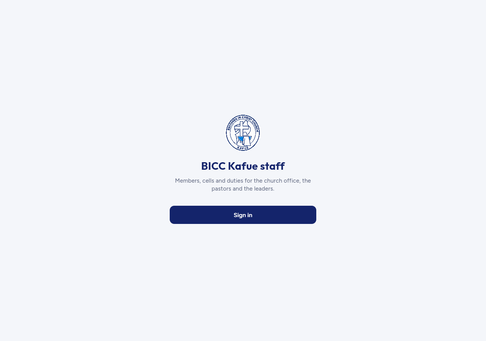
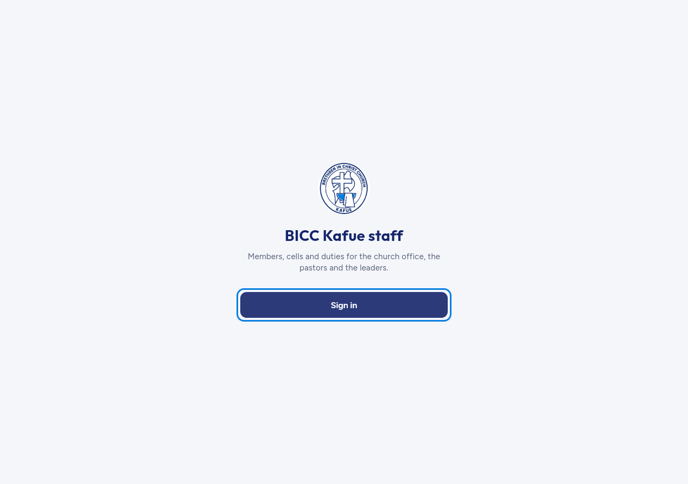
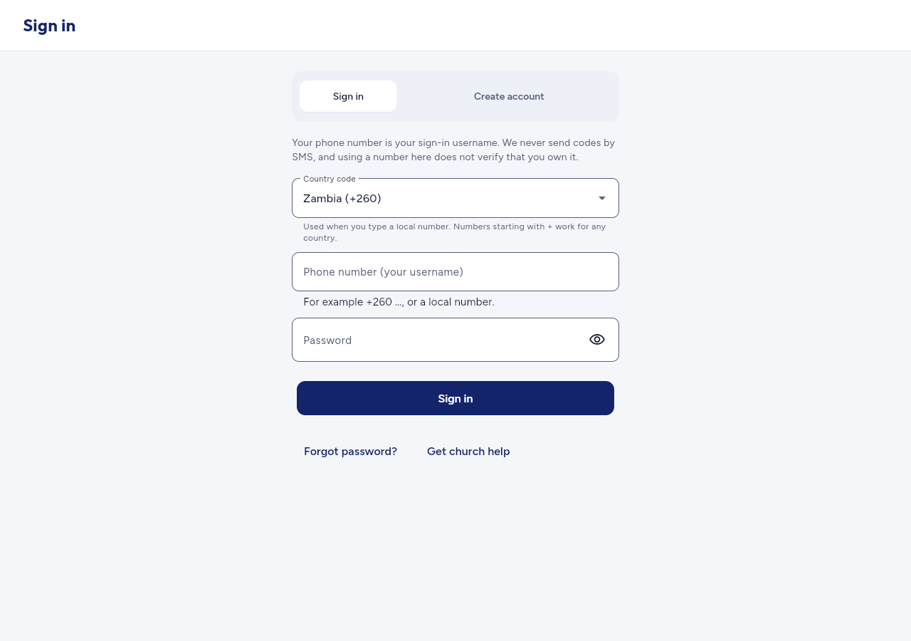
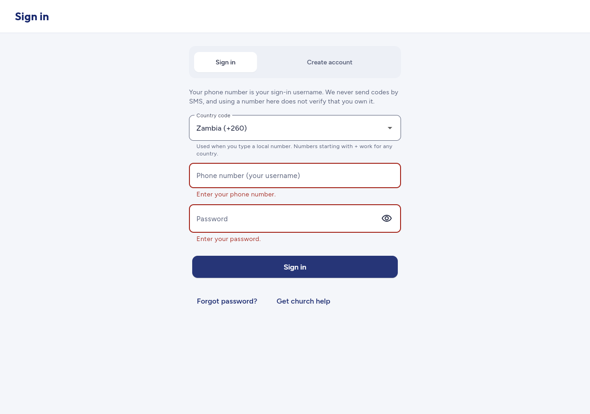
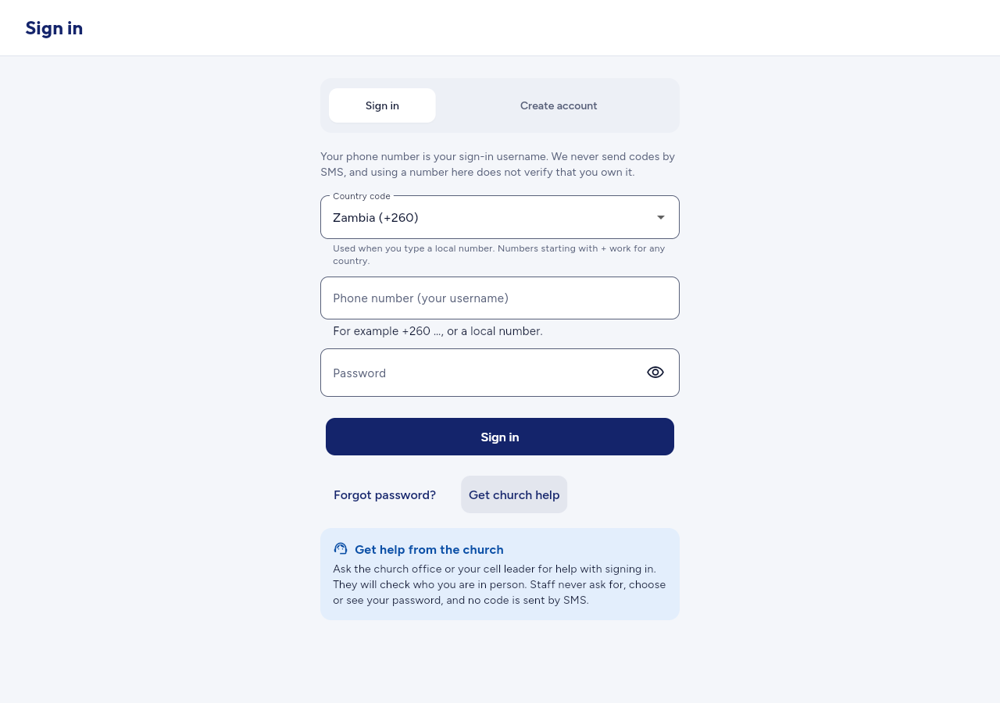
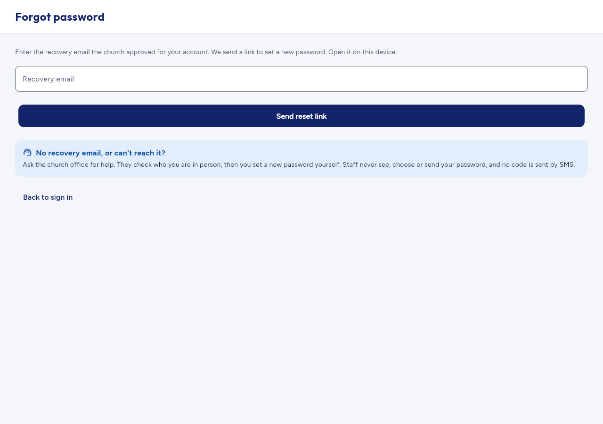
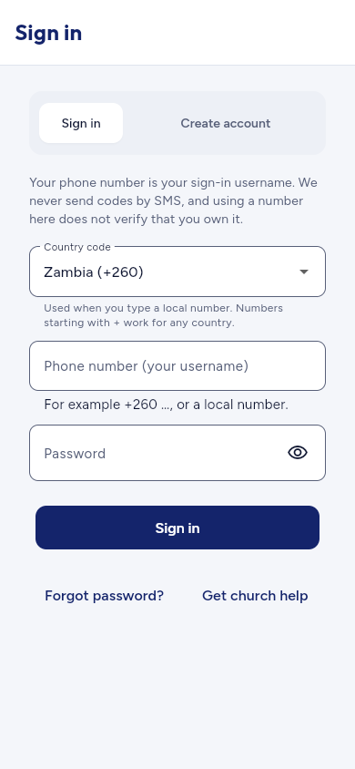
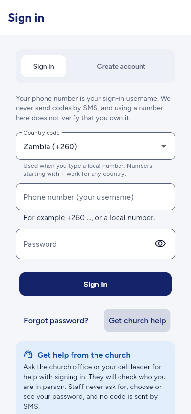

# Current staff web: signed-out browser smoke

## Summary

**17/17 checks passed** against the actual Flutter release app in a fresh signed-out browser context. The verified path is **landing → keyboard sign-in → empty-field validation → mode switch/recovery → password visibility → church help → forgot-password entry → Back to sign in → reload**, followed by a narrow viewport and scroll check. No runtime source was changed.

This is **rendered UI evidence only**. Although the build consumed the staging public-client configuration privately, the current signed-out staff path makes **zero backend API requests**. It cannot establish backend authorization, authenticated command behavior, failed-login retries, actual password recovery, or device acceptance.

## Environment

- Candidate: `c655dac95766011a22e3f6eb6cff674af2396b13`.
- Final run: `2026-10-30T20:13:56.063Z` to `2026-10-30T20:14:05.966Z`.
- Flutter 3.47.6 / Dart 3.13.5; Node 22.23.4; Playwright 1.62.1; Chrome for Testing 151.0.7922.34.
- Browser plugin not available; the installed Playwright package and installed headless Chrome were used. No new browser dependencies were installed for this follow-up.
- Loopback origin: `http://127.0.0.1:39809/` (temporary server stopped at completion).
- Viewports: **1280×900** and **390×844**; browser locale `en-GB`.
- Staging URL/key read privately from `/tmp/church-app-staging-public-client.json`. Values were never printed or copied into evidence. The configured build lives at `/tmp/church-app-staff-staging-browser-web` and is not committed or deployed.
- Fresh context, service workers blocked, no existing sign-in/session. A browser route guard allowed only GET/HEAD/OPTIONS to the loopback app or configured staging origin. Request headers, bodies, HAR and traces were not captured. **Zero mutation attempts; zero staging requests.**

## Checks and evidence

| Area | Observed result |
| --- | --- |
| Page identity and nonblank rendering | Correct title, church logo, named heading and Sign in action; meaningful accessibility tree. |
| Signed-out navigation | Landing exposes one entry action; no staff sidebar or protected sections. |
| Keyboard access | Tab reaches Sign in; Enter opens the form; phone, password, submit, forgot-password and help controls are reachable by Tab. |
| Accessible controls | Phone/password fields and actions have accessible names; sign-in/create-account choices expose radio state; password toggle changes the action name. |
| Local failure/recovery | Empty Sign in shows both field errors without network traffic; switching mode and back clears the local validation state. |
| Recovery entry | Church-help guidance renders; Forgot password opens its form; Back to sign in returns to empty fields. No address was entered or submitted. |
| Reload | The sign-in route renders again after reload, still signed out. |
| Narrow viewport | Fields fit inside 390 px; actual scrolling element width is 390 and attempted horizontal scroll remains 0; help is reachable by vertical scrolling. |
| Console/runtime | No page errors and no framework overlay. Four software WebGL ReadPixels performance warnings were recorded; they are not application exceptions. |
| Network boundary | All observed requests were local GET asset reads. No auth submission, email, notification, account creation or mutation attempt. |

[results.json](results.json) contains all 17 assertions, accessible snapshots, exact focus traversal, layout measurements, sanitized console records and request methods/paths. This is a semantics/keyboard smoke, not a full screen-reader, contrast, zoom or accessibility certification.

## Preserved harness observations

The final assertions follow the actual Flutter DOM, rather than assumptions about it. Earlier incomplete attempts remain in `attempt-1.json`, `attempt-2.json` and `attempt-3.json`:

1. Flutter focus updates after the key event. The first immediate DOM read saw the host element even though Enter opened sign-in. Waiting for the named focused action resolved the measurement.
2. Hovering the password toggle retained tooltip semantics, and the help banner combines its title/body into one accessible heading. The visible controls worked; the final locators use the observed semantics and move the pointer away before reading the toggle name.
3. Flutter's body reported 1100 px because its hidden/semantic DOM is wider than the visual viewport. The actual scrolling element was 390 px and the fields fit. The final check attempts a horizontal scroll and observes `scrollX = 0`, preserving the original body-width value for review.

No product code was altered to make these checks pass. The earlier failed locator/measurement attempts are not presented as passing runs or as established product defects.

## Reproduce this bounded check

The final [smoke.mjs](smoke.mjs) is the script that ran. It starts a temporary loopback-only static server, opens a fresh browser context, enforces the read-only request guard and closes both browser and server. It reads the private config solely for origin allowlisting and log redaction; the compiled app itself supplies its client configuration.

The one additional build was necessary because the previous generic CI build had no compile-time Supabase configuration:

```bash
# From apps/staff; public-client file stays private and outside Git.
flutter build web --no-pub --no-web-resources-cdn --no-wasm-dry-run \
  --dart-define-from-file=/tmp/church-app-staging-public-client.json \
  --output=/tmp/church-app-staff-staging-browser-web
```

The recorded execution used:

```bash
/workspace/scratch/308c700530ee/toolchains/node-v22.23.4-linux-x64/bin/node \
  /workspace/scratch/308c700530ee/staff_signed_out_probe.mjs
```

For another host, use Node 22 and an available Playwright 1.62.1 module plus compatible Chromium, then set `REPO_ROOT`, `STAFF_WEB_BUILD`, `STAGING_PUBLIC_CLIENT_CONFIG`, `PLAYWRIGHT_MODULE` and `CHROMIUM_EXECUTABLE` before running the checked-in `smoke.mjs` copy. The module and executable paths are explicit dependencies, not project npm packages. The script writes into this dated candidate evidence directory; run in a separate disposable checkout for a later candidate so the original dated evidence stays intact.

## Remaining scope

Authenticated role navigation, real RPC/read failures and retry, RLS outcomes, signed-in content workflows, actual recovery email, physical-device/browser combinations, and a complete accessibility audit remain unverified by this smoke. No pilot or acceptance approval is implied. The no-API result is expected for the normal signed-out staff flow; it must not be described as successful staging backend validation.

## Screenshots

The final screenshot set is eight PNGs; two additional images preserve the earlier locator observations. Each is below 65 KB. [screenshot-manifest.json](screenshot-manifest.json) records exact bytes and SHA256.









